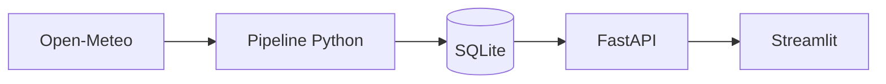

# Observatoire Météo

Application de collecte, stockage et visualisation de données météo en temps réel via l'API Open-Meteo.



## Structure du projet

```text
Projet-Meteo-HTTP-Request-1/
├── api/                    # Routes FastAPI et dépendances
│   ├── deps.py             # Injection de la session BDD
│   └── v1/
│       ├── router.py       # Agrégation des routes
│       ├── schemas/        # Schémas de réponse (Pydantic)
│       └── routes/         # Endpoints météo
├── core/                   # Configuration et socle technique
│   ├── config.py           # Variables d'environnement
│   ├── database.py         # Moteur SQLite / SQLModel
│   ├── client.py           # Client HTTP Open-Meteo
│   ├── schemas/            # Schémas Pydantic Open-Meteo
│   └── api.py              # Application FastAPI
├── models/                 # Modèles de données (SQLModel)
│   └── ville.py            # Tables Ville et Releve
├── repositories/           # Requêtes et accès aux données
│   └── ville_repository.py
├── services/               # Logique métier
│   └── ville_service.py    # Collecte et initialisation des villes
├── dashboard/              # Dashboard utilisateur
│   └── app.py              # Application Streamlit
├── data/                   # Base SQLite locale (meteo.db)
├── tests/                  # Tests unitaires pytest
├── main.py                 # Script de démo
├── requirements.txt
└── README.md
```

## Installation

```bash
# Créer et activer l'environnement virtuel
python -m venv .venv
source .venv/bin/activate

# Installer les dépendances
pip install -r requirements.txt
```

## Utilisation

### 1. Lancer les tests
```bash
pytest
```

### 2. Alimenter la base de données
```bash
python main.py
```

### 3. Démarrer l'API (FastAPI)
```bash
uvicorn core.api:app --reload
```
- API racine : `http://127.0.0.1:8000/`
- Documentation Swagger : `http://127.0.0.1:8000/docs`

### 4. Démarrer le Dashboard (Streamlit)
Dans un second terminal :
```bash
streamlit run dashboard/app.py
```
- Interface accessible sur `http://localhost:8501`
