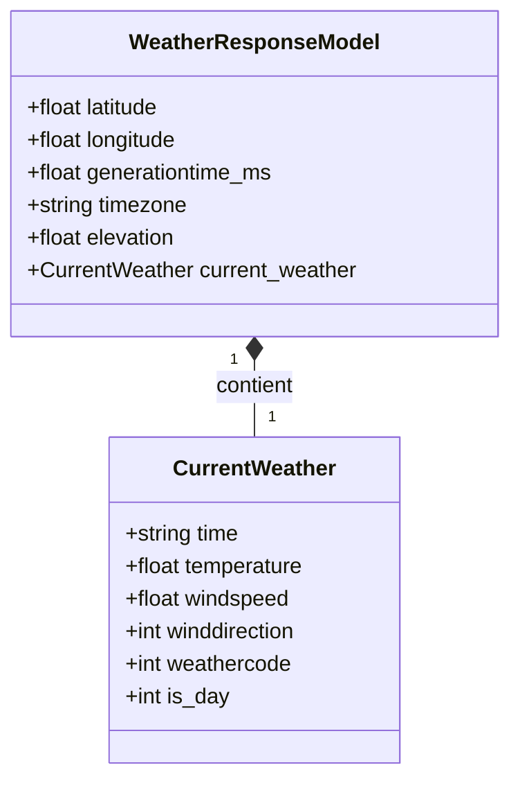

# 🌤️ Projet Météo - Client HTTP & Validation Pydantic

Projet de récupération, validation et structuration de données météorologiques via l'API **Open-Meteo**, utilisant des requêtes HTTP robustes et la validation de schémas avec **Pydantic v2**.

---

## 📐 Modèle Conceptuel de Données (MCD)

Le modèle ci-dessous illustre la structure des données récupérées depuis l'API Open-Meteo et leur organisation en classes Python :



---

### Dictionnaire des Données

#### 1. Entité racine : `WeatherResponseModel`
Correspond à la réponse globale renvoyée par le point d'accès `/v1/forecast`.

| Attribut | Type Python | Exemple | Description |
|---|---|---|---|
| `latitude` | `float` | `48.8566` | Latitude géographique du lieu |
| `longitude` | `float` | `2.3522` | Longitude géographique du lieu |
| `generationtime_ms` | `float` | `0.045` | Temps de génération côté serveur (ms) |
| `timezone` | `str` | `"Europe/Paris"` | Fuseau horaire appliqué |
| `elevation` | `float` | `42.0` | Altitude du lieu en mètres |
| `current_weather` | `CurrentWeather` | *(objet)* | Données météo instantanées |

#### 2. Sous-entité imbriquée : `CurrentWeather`
Correspond au bloc `current_weather` imbriqué dans la réponse.

| Attribut | Type Python | Exemple | Description |
|---|---|---|---|
| `time` | `str` | `"2026-11-02T14:00"` | Horodatage du relevé météo (format ISO 8601) |
| `temperature` | `float` | `13.5` | Température instantanée (°C) |
| `windspeed` | `float` | `12.4` | Vitesse du vent (km/h) |
| `winddirection` | `int` | `210` | Direction du vent en degrés (0° à 360°) |
| `weathercode` | `int` | `3` | Code condition météo WMO (ex: 0=Ciel dégagé, 3=Couvert) |
| `is_day` | `int` | `1` | Indicateur diurne/nocturne (1 = jour, 0 = nuit) |

---

## 🗂️ Structure du Projet

```text
Projet-Meteo-HTTP-Request-1/
├── schemas/            # Schémas de validation Pydantic (WeatherResponseModel, CurrentWeather)
├── tests/              # Tests unitaires automatisés (pytest) pour schémas et client
├── client.py           # Client HTTP (OpenMeteoClient) avec requêtes robustes et validation
├── main.py             # Point d'entrée pour tester la récupération et l'affichage des données
├── .gitignore          # Fichiers ignorés par Git
├── requirements.txt    # Dépendances du projet (requests, pydantic, pytest...)
└── README.md           # Documentation & MCD
```

---

## 🚀 Installation & Démarrage

1. **Activer l'environnement virtuel** :
   ```bash
   source .venv/bin/activate
   ```

2. **Installer les dépendances** :
   ```bash
   pip install -r requirements.txt
   ```

3. **Lancer les tests unitaires** :
   ```bash
   pytest
   ```

4. **Lancer le script de démonstration** :
   ```bash
   python main.py
   ```
