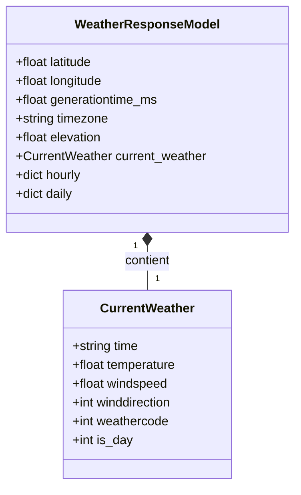
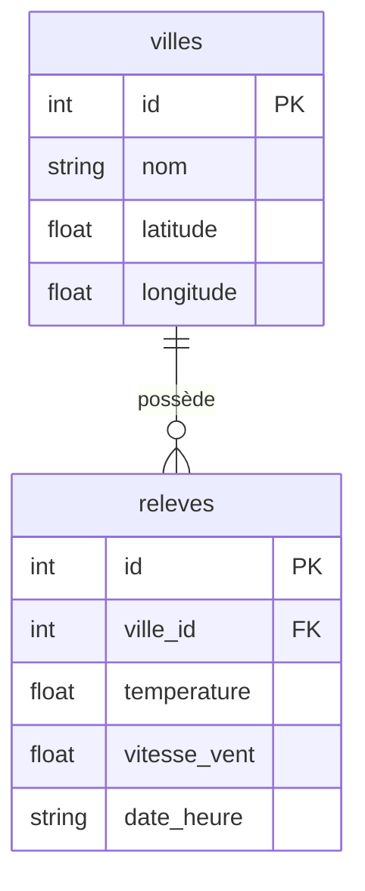

# 🌤️ Projet Fil Rouge : L'Observatoire Météo

Application de collecte, validation et persistance de données météorologiques via l'API **Open-Meteo**, utilisant des requêtes HTTP robustes, la validation stricte de schémas avec **Pydantic v2** et le stockage relationnel avec **SQLite**.

---

## 📐 Modélisation des Données

### 1. Modèle Conceptuel de Données (Pydantic)

Le modèle ci-dessous illustre la structure des données reçues depuis l'API Open-Meteo et manipulées en mémoire :



### 2. Modèle Relationnel de la Base de Données (SQLite)

Le schéma ci-dessous présente les tables relationnelles stockées dans `meteo.db` :



---

### Dictionnaire des Données

#### 1. Entité racine : `WeatherResponseModel`
Correspond à la réponse globale renvoyée par le point d'accès `/v1/forecast`.

| Attribut | Type Python | Exemple | Description |
|---|---|---|---|
| `latitude` | `float` | `48.8566` | Latitude géographique du lieu |
| `longitude` | `float` | `2.3522` | Longitude géographique du lieu |
| `generationtime_ms` | `float` | `0.045` | Temps de génération côté serveur (ms) |
| `timezone` | `str` | `"Europe/Paris"` | Fuseau horaire appliqué |
| `elevation` | `float` | `42.0` | Altitude du lieu en mètres |
| `current_weather` | `CurrentWeather` | *(objet)* | Données météo instantanées |
| `hourly` | `Optional[dict]` | `None` | Données météo horaires optionnelles |
| `daily` | `Optional[dict]` | `None` | Données météo journalières optionnelles |

#### 2. Sous-entité imbriquée : `CurrentWeather`
Correspond au bloc `current_weather` imbriqué dans la réponse.

| Attribut | Type Python | Exemple | Description |
|---|---|---|---|
| `time` | `str` | `"2026-11-02T14:00"` | Horodatage du relevé météo (format ISO 8601) |
| `temperature` | `float` | `13.5` | Température instantanée (°C) |
| `windspeed` | `float` | `12.4` | Vitesse du vent (km/h) |
| `winddirection` | `int` | `210` | Direction du vent en degrés (0° à 360°) |
| `weathercode` | `int` | `3` | Code condition météo WMO (ex: 0=Ciel dégagé, 3=Couvert) |
| `is_day` | `int` | `1` | Indicateur diurne/nocturne (1 = jour, 0 = nuit) |

---

## 🗂️ Structure du Projet

```text
Projet-Meteo-HTTP-Request-1/
├── schemas/            # Schémas de validation Pydantic (WeatherResponseModel, CurrentWeather)
├── tests/              # Tests unitaires automatisés (pytest) pour schémas, client, base et pipeline
├── client.py           # Client HTTP (OpenMeteoClient) avec requêtes robustes et validation
├── database.py         # Gestion de la base SQLite (tables villes et releves, requêtes, statistiques)
├── pipeline.py         # Pipeline de collecte et persistance multi-villes (API -> Pydantic -> SQLite)
├── main.py             # Point d'entrée de démonstration (collecte, validation, insertion, stats)
├── .env.example        # Exemple de configuration des variables d'environnement
├── .gitignore          # Fichiers ignorés par Git (dont *.db et .venv/)
├── requirements.txt    # Dépendances du projet (requests, pydantic, python-dotenv, pytest)
└── README.md           # Documentation, MCD & schéma relationnel
```

---

## 🚀 Installation & Démarrage

1. **Activer l'environnement virtuel** :
   ```bash
   source .venv/bin/activate
   ```

2. **Installer les dépendances** :
   ```bash
   pip install -r requirements.txt
   ```

3. **(Optionnel) Configurer les variables d'environnement** :
   ```bash
   cp .env.example .env
   ```

4. **Lancer la suite de tests unitaires (41 tests)** :
   ```bash
   pytest
   ```

5. **Lancer le script de démonstration** :
   ```bash
   python main.py
   ```

6. **Exécuter le pipeline complet de collecte multi-villes** :
   ```bash
   python pipeline.py
   ```
