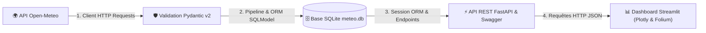
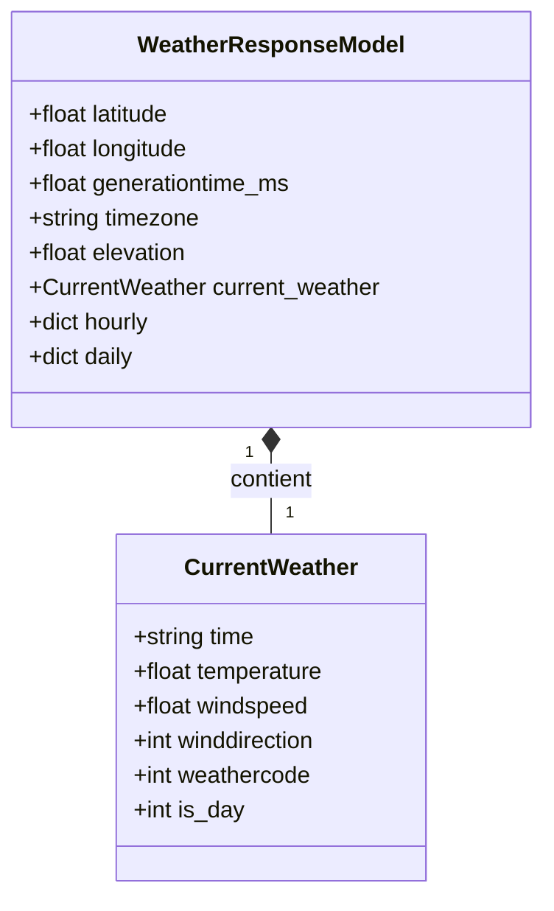
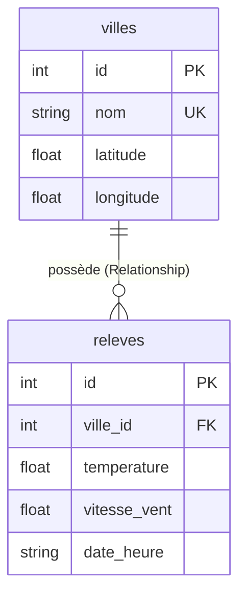

# 🌤️ Projet Fil Rouge : L'Observatoire Météo

Application complète de collecte, validation, persistance ORM, exposition API et visualisation interactive de données météorologiques en temps réel.

---

## 🏗️ Architecture Globale (Jours 1 à 4)



* **Jour 1 — Réseau & Validation** : Client HTTP robuste (`requests.Session`, timeouts, gestion d'erreurs) et validation stricte des réponses entrantes avec **Pydantic v2**.
* **Jour 2 — Persistance & ORM** : Modélisation relationnelle et persistance dans **SQLite** via l'ORM **SQLModel** (`Ville`, `Releve`, `Relationship`, `Session`, agrégations SQL).
* **Jour 3 — Exposition API REST** : Serveur web **FastAPI** exposant les relevés et statistiques, documenté automatiquement avec **Swagger UI** (`/docs`).
* **Jour 4 — Dashboard Interactif** : Interface frontend **Streamlit** connectée à FastAPI avec cartes de métriques (KPIs), courbes interactives **Plotly** et carte géographique **Folium**.

---

## 📐 Modélisation des Données

### 1. Schémas de Validation Entrants (Pydantic v2)



### 2. Modèles Relationnels ORM (SQLModel / SQLite)



---

## 🗂️ Structure du Projet

```text
Projet-Meteo-HTTP-Request-1/
├── schemas/            # Schémas de validation Pydantic (WeatherResponseModel, CurrentWeather)
├── tests/              # Suite de 42 tests unitaires automatisés (pytest)
├── client.py           # Client HTTP (OpenMeteoClient) avec requêtes robustes et validation
├── database.py         # Modèles ORM SQLModel (Ville, Releve), engine SQLite, CRUD et statistiques
├── pipeline.py         # Pipeline de collecte et persistance multi-villes (API -> Pydantic -> SQLModel)
├── app.py              # Serveur API REST FastAPI avec documentation automatique Swagger
├── dashboard.py        # Dashboard interactif Streamlit (KPIs, graphiques Plotly, carte Folium)
├── main.py             # Script de démonstration unitaire
├── .env.example        # Exemple de configuration des variables d'environnement
├── .gitignore          # Fichiers ignorés par Git (*.db, .venv/, __pycache__/)
├── requirements.txt    # Dépendances du projet
└── README.md           # Documentation & architecture
```

---

## 🚀 Installation & Démarrage

### 1. Activer l'environnement virtuel et installer les dépendances
```bash
source .venv/bin/activate
pip install -r requirements.txt
```

### 2. Lancer la suite de tests unitaires (42 tests)
```bash
pytest -v
```

### 3. Alimenter la base de données (Pipeline multi-villes)
```bash
python pipeline.py
```

### 4. Démarrer le serveur API FastAPI (Terminal 1)
```bash
uvicorn app:app --reload
```
* **API Racine (Statistiques globales)** : `http://127.0.0.1:8000/`
* **Météo d'une ville** : `http://127.0.0.1:8000/meteo/Paris`
* **Historique d'une ville** : `http://127.0.0.1:8000/meteo/Paris/historique`
* **Documentation interactive Swagger UI** : `http://127.0.0.1:8000/docs`

### 5. Démarrer le Dashboard Interactif Streamlit (Terminal 2)
```bash
streamlit run dashboard.py
```
* **Interface Web** : `http://localhost:8501`
